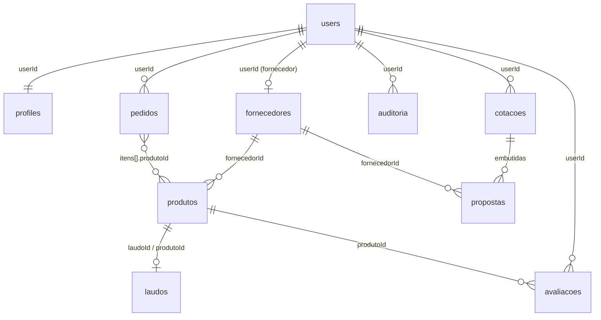

# Modelo de dados — AgroRecursos MarketPlace

Banco: MongoDB (`agrorecursos`). Acesso pelo driver oficial `mongodb`. Os índices são criados na inicialização (`backend/src/config/database.js`).

## Modelo lógico

## Decisões de normalização

- **Referência** entre entidades que existem sozinhas e são consultadas por diferentes telas: `users`, `profiles`, `fornecedores`, `produtos`, `laudos`, `avaliacoes`.
- **Incorporação (embedding)** onde o dado só faz sentido dentro do dono e é lido junto com ele: `propostas` dentro de `cotacoes`; `itens`, `entrega` e `pagamento` dentro de `pedidos`.
- Os `itens` do pedido guardam uma **cópia** de nome e preço no momento da compra (histórico imutável); o total é sempre recalculado no servidor a partir do preço do produto.
- Médias (`fornecedores.avaliacao`) são recalculadas a cada avaliação nova e guardadas, para evitar agregação a cada leitura do catálogo.
- Produtos nunca são apagados fisicamente: `ativo: false` preserva pedidos e laudos antigos.

## Modelo físico (coleções)

### users
| Campo | Tipo | Observação |
|---|---|---|
| _id | ObjectId | |
| email | string | único |
| passwordHash | string | bcrypt, custo 12 |
| status | string | `active` ou `inactive` |
| emailVerified | bool | |
| createdAt / updatedAt | date | |

### profiles
| Campo | Tipo | Observação |
|---|---|---|
| userId | ObjectId | único, referencia `users` |
| name, accountType | string | `produtor` ou `fornecedor` |
| document | string | CPF/CNPJ só com dígitos; único quando preenchido |
| phone | string | |
| companyName, tradeName, stateRegistration | string | fornecedor |
| categories | string[] | categorias que o fornecedor vende |
| address | objeto | cep, street, number, complement, neighborhood, city, state |
| registrationStatus | string | `basic` ou `complete` |

### fornecedores
`userId` (opcional), `nome`, `nomeFantasia`, `avaliacao` (média 0–5), `totalAvaliacoes`, `criadoEm`.

### produtos
| Campo | Tipo | Observação |
|---|---|---|
| nome, categoria, marca, regiao | string | categoria: Sementes, Fertilizantes, Defensivos, Outros |
| preco | number | em reais, 2 casas |
| entregaDias, estoque, vendidos | number | |
| cultura, tecnologia, embalagem, descricao, vencimento, condicao | string | |
| germinacao, vigor, pureza | number | sementes |
| fornecedorId | ObjectId | referencia `fornecedores` |
| laudoId | ObjectId ou null | referencia `laudos` |
| chave | string | `nome|marca` normalizado; impede duplicados por fornecedor |
| ativo | bool | exclusão lógica |

### laudos
`numero` (único, ex.: `MAPA-00123`), `orgao`, `produtoId`, `fornecedorId`, `emissao`, `validade`, `resultados` (objeto), `criadoEm`.

### avaliacoes
`produtoId`, `userId`, `nota` (1–5), `comentario`, `autor`, `verificado` (comprou o produto), `criadoEm`, `atualizadoEm`. Uma por usuário e produto.

### cotacoes
`codigo` (único, `CR00001`), `userId`, `item`, `quantidade`, `produtoId` (opcional), `criadoEm`, `vencimento`, `status` (`aguardando`, `analise`, `fechada`, `recusada`), `propostaAprovadaId`, `propostas[]` com `_id`, `fornecedorId`, `fornecedor`, `preco`, `prazo`, `laudo`, `avaliacao`.
Documentos com `modelo: true` são modelos de exemplo copiados para cada produtor no primeiro acesso.

### pedidos
`numero` (`PED000001`), `userId`, `itens[]` (produtoId, fornecedorId, nome, preco, quantidade, subtotal), `subtotal`, `frete` (valor, prazo), `total`, `entrega` (endereço), `pagamento` (metodo, parcelas, valorParcelas[], status), `status` (`aguardando_pagamento`, `em_analise`, `pago`, `enviado`, `entregue`, `cancelado`).

### auditoria
`userId`, `acao` (ex.: `login`, `produto.criado`, `pedido.criado`, `cotacao.aprovada`), `entidade`, `entidadeId`, `detalhes`, `ip`, `criadoEm`. Nunca guarda senhas.

### Coleções de apoio
`sessions` (connect-mongo), `password_resets` (token em hash SHA-256, expira em 1 h por índice TTL), `counters` (sequências de cotação e pedido).

## Índices

| Coleção | Índice | Tipo |
|---|---|---|
| users | email | único |
| profiles | userId; document | único (document só quando existe) |
| produtos | categoria+marca; fornecedorId; vendidos; fornecedorId+chave (ativos) | o último é único |
| laudos | numero | único |
| avaliacoes | produtoId+userId | |
| cotacoes | userId+criadoEm; codigo | codigo único |
| pedidos | userId+criadoEm; itens.fornecedorId | |
| auditoria | userId+criadoEm | |
| password_resets | expiresAt (TTL); tokenHash | |

## Regras de integridade aplicadas na API

- Produto duplicado (mesmo nome e marca para o mesmo fornecedor) é recusado, inclusive na importação CSV.
- Produto com pedido em andamento não pode ser removido; cotação com propostas não pode ser excluída.
- Conta com pedidos em andamento não pode ser encerrada (a conta fica `inactive`, não é apagada).
- Exportação de pedidos em CSV só é liberada quando nenhum pedido está aguardando pagamento ou em análise.
